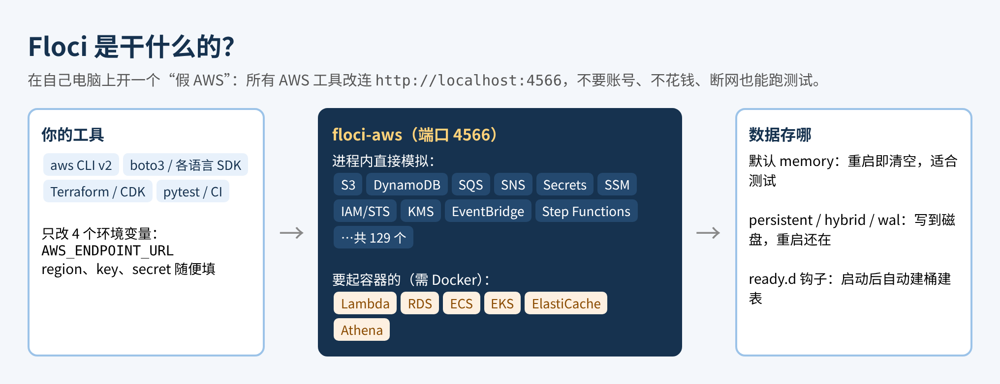
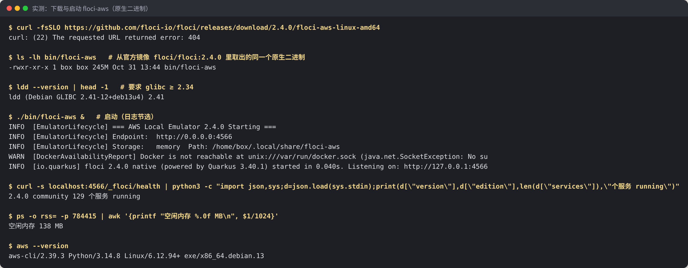
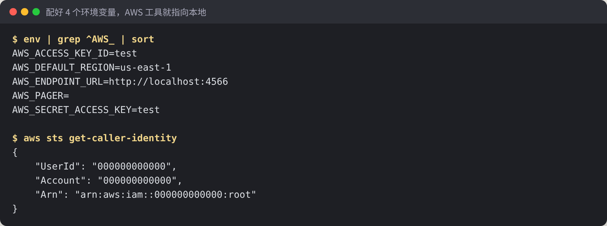
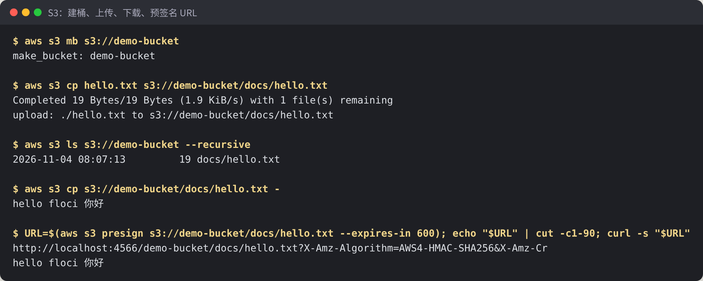
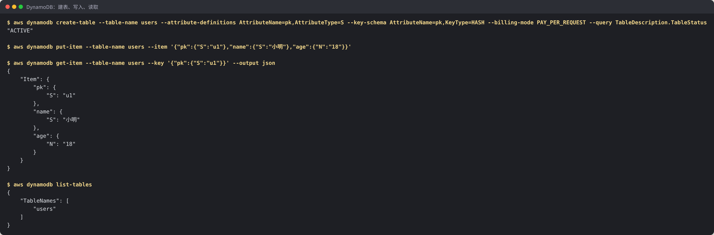

# Floci 中文教程：免费的本地 AWS 模拟器，LocalStack 收费后的替代品（实测）

> **非官方中文教程**。原项目 [floci-io/floci](https://github.com/floci-io/floci)（MIT 许可），本仓库与原作者无关。

📚 免费版讲“是什么、和 LocalStack 的区别、怎么装（含 404 的坑）、怎么让 AWS 工具连到本地、S3 和 DynamoDB 实测”。完整版（SNS→SQS 消息、Secrets/SSM、boto3 测试、CLI v1 连到真 AWS 的坑、无 Docker 时的 Lambda、持久化、启动钩子、局限汇总、全部脚本）在知识星球「开源抢先站」：[https://t.zsxq.com/mc4td](https://t.zsxq.com/mc4td)

🎟️ 首发 6 折：新人先领 20 元券，50 元变 30 元（限 50 张，11 月 29 日截止）👉 [领券](https://t.zsxq.com/jk0TT)
>
>
> 适用版本：Floci `2.4.0`（2026-10-31 发布）+ AWS CLI v2.39 + boto3｜实测日期：2026-11-04｜实测环境：Linux x86_64（Debian 13），**没有 Docker**
> 文中终端截图全部来自真机实测。没实测的部分标了「⚠️ 未实测」。

## 0. 先说结论：值不值得用？

写 AWS 相关的代码，最麻烦的是测试：连真 AWS 要账号、要花钱、还怕删错东西。以前大家用 LocalStack 在本地模拟 AWS，但它的社区版 2026 年 3 月起要登录令牌、安全更新也停了。Floci 就是冲着这个来的免费替代品：MIT 协议、不要账号、不要令牌，GitHub 2.8 万星，这几天在热榜上。

我的实测结论：

- **真的能当“本地 AWS”用。** 配好 4 个环境变量，`aws` 命令和 boto3 代码一行不改就连到本地。S3、DynamoDB、SQS、SNS、Secrets Manager、SSM 我都跑通了（第 3–6 节）。
- **快。** 启动 0.04–0.07 秒；用 boto3 跑 50 次“下单”测试（写 S3 + 写 DynamoDB + 发 SQS + 全部读回校验）只要 0.58 秒（第 7 节）。
- **没有 Docker 也能跑大半。** 不需要容器的服务都正常；Lambda、RDS 这类要起容器的，没 Docker 时能建、不能跑（第 9 节）。
- **有坑。** 2.4.0 的 Release 页面上没挂原生二进制，下载地址 404；老版 AWS CLI v1 的 SQS 命令会无视 `AWS_ENDPOINT_URL`、把请求发到真 AWS；默认重启后数据全清空（第 2、8、10 节）。
- **和 README 宣传的数字有出入。** README 说空闲内存约 13 MiB、二进制约 40 MB，我实测进程常驻内存约 137 MB、二进制 245 MB（第 2 节）。对本地开发来说依然很轻，但别按宣传值去算 CI 机器的内存。

一句话：**项目用到 S3、DynamoDB、SQS 这类常见服务，想在本地或 CI 里免费测试，值得装；重度依赖 Lambda、RDS 的，得配 Docker 一起用。**

## 1. 它是什么？



Floci 是一个“AWS 模拟器”：在你电脑上开一个服务，监听 `4566` 端口，说的是和真 AWS 一样的接口协议。所有 AWS 工具（CLI、各语言 SDK、Terraform、CDK）只要把地址指向 `http://localhost:4566`，就会以为自己在和 AWS 说话。

它和 LocalStack 用的是同一个端口，官方说可以“换个镜像就迁过来”。README 里的对比：

| 对比项 | Floci | LocalStack 社区版 |
|---|---|---|
| 要登录令牌 | 不要 | 要 |
| 安全更新 | 有 | 已冻结 |
| 许可 | MIT | 受限 |
| 启动时间（官方数据） | 约 24 ms | 约 3.3 s |
| 原生二进制（不用 Docker） | 有 | 没有 |
| API Gateway v2、Cognito | 支持 | 不支持 |

> 表里的 LocalStack 数据是 Floci 官方给的，我没有装 LocalStack 对比（⚠️ 未实测）。Floci 这边我实测启动 0.040 秒和 0.068 秒（两次）。

## 2. 安装和启动

官方推荐两种方式：

```bash
# 方式一：Docker Compose（推荐）
# compose.yaml 里写 image: floci/floci:latest，端口 4566:4566
docker compose up

# 方式二：官方 CLI
floci start
```

我的机器上没有 Docker，所以用第三种：**原生二进制**，一个文件直接运行。文档说每个 Release 都附带 `floci-aws-linux-amd64` 等文件，但我下载 2.4.0 时**返回 404**，Release 页面上确实一个附件都没有（2.0.1 到 2.4.0 都是）。

**解决办法**：文档写明“Linux 二进制和 Docker 镜像里的是同一个原生构建”，所以我从官方镜像 `floci/floci:2.4.0` 的最后一层里把 `/app/application` 取了出来，改名 `floci-aws`，直接就能运行。不想折腾的话，有 Docker 就用方式一（⚠️ 未实测 Docker 和 floci CLI 方式）。



几点说明：

- 要求 **glibc 2.34 以上**（Ubuntu 22.04、Debian 12 及以后都行），Alpine 这类 musl 系统跑不了。
- 启动日志里会有一条 `Docker is not reachable` 警告，列出哪些服务没 Docker 用不了，**这是正常的**，不影响其他服务。
- 健康检查地址 `http://localhost:4566/_floci/health`，返回版本号和每个服务的状态，实测列出 129 个服务。
- 实测进程常驻内存约 137 MB，二进制 245 MB，比 README 写的大不少（见第 0 节）。

## 3. 让 AWS 工具连到本地：4 个环境变量

```bash
export AWS_ENDPOINT_URL=http://localhost:4566
export AWS_DEFAULT_REGION=us-east-1
export AWS_ACCESS_KEY_ID=test
export AWS_SECRET_ACCESS_KEY=test
```

`AWS_ENDPOINT_URL` 是 AWS 官方 SDK 和 CLI v2 都认的变量，设了它，所有服务的请求都发到本地。账号密钥随便填非空的值就行，Floci 默认不校验。



`aws sts get-caller-identity` 返回账号 `000000000000`，说明已经连到 Floci，而不是真 AWS。

> 一定要用 **AWS CLI v2**。v1 有个坑，见第 8 节。

## 4. S3：建桶、上传、下载、预签名

```bash
aws s3 mb s3://demo-bucket
aws s3 cp hello.txt s3://demo-bucket/docs/hello.txt
aws s3 ls s3://demo-bucket --recursive
aws s3 cp s3://demo-bucket/docs/hello.txt -
aws s3 presign s3://demo-bucket/docs/hello.txt --expires-in 600
```



中文内容原样存取。预签名 URL 指向 `localhost:4566`，用 `curl` 不带任何密钥就能下载，适合测“给前端发临时下载链接”这类逻辑。

## 5. DynamoDB：建表、写入、读取

```bash
aws dynamodb create-table --table-name users \
  --attribute-definitions AttributeName=pk,AttributeType=S \
  --key-schema AttributeName=pk,KeyType=HASH \
  --billing-mode PAY_PER_REQUEST
aws dynamodb put-item --table-name users \
  --item '{"pk":{"S":"u1"},"name":{"S":"小明"},"age":{"N":"18"}}'
aws dynamodb get-item --table-name users --key '{"pk":{"S":"u1"}}'
```



建表后状态直接是 `ACTIVE`，不用像真 AWS 那样等几秒。GSI、TTL、事务、Streams 官方说支持，我只测了最基本的读写（⚠️ 未实测其余功能）。

## 6. 完整版还讲了什么

| 章节 | 一句话简介 |
|---|---|
| SNS → SQS 消息 | 发布一条消息、队列里收到，RawMessageDelivery 的作用；Secrets Manager、SSM 参数 |
| boto3 业务测试 | 不改一行代码连本地，50 次下单测试 0.58 秒；放进 CI 的思路 |
| CLI v1 的坑 | SQS 无视 `AWS_ENDPOINT_URL`、请求发到真 AWS，怎么发现、怎么解决 |
| 没有 Docker 时 | Lambda 能建不能跑，哪些服务必须有 Docker |
| 持久化和启动钩子 | 四种存储模式怎么选；`ready.d` 启动时自动建桶建队列 |
| 局限和踩坑汇总、实测清单 | 6 个常见问题的现象和解决办法；哪些测了、哪些没测 |

---

## 加入知识星球「开源抢先站」看完整版

[https://t.zsxq.com/mc4td](https://t.zsxq.com/mc4td)


**微信扫码加入星球，先领 20 元券**

🎟️ 首发 6 折新人券（20 元，50 元变 30 元，限 50 张，2026-11-29 截止）：[https://t.zsxq.com/jk0TT](https://t.zsxq.com/jk0TT)

---

## 来源与许可

- 原项目：https://github.com/floci-io/floci ，采用 **MIT 许可**，版权归 “Floci and its contributors”。本教程是独立撰写的非官方使用教程，与 Floci 没有隶属或背书关系；命令名和输出文本属于原项目。AWS 及各服务名称是 Amazon 的商标。
- 文中所有截图都是在一台没有 Docker 的 Linux 机器上实测得到的，测试脚本均为本文作者所写。
- 本教程的文字与图片采用 CC BY-NC-SA 4.0 许可。
